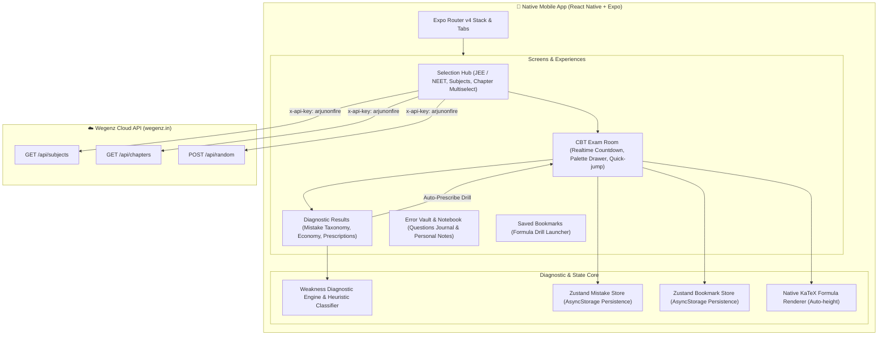

<div align="center">

# 📱 Wegenz Practice Mobile

**Pure Native React Native & Expo Mobile App for High-Speed JEE & NEET CBT Examination & Diagnostic Drills**

[](https://github.com/Fire162/wegenz-mobile/actions/workflows/build-android.yml)
[](https://expo.dev)
[](https://reactnative.dev)
[](https://www.typescriptlang.org)
[](https://pnpm.io)
[](LICENSE)

</div>

---

## ⚡ Overview

**Wegenz Practice Mobile** is a lightning-fast, zero-lag React Native application built with **Expo SDK 52** and **Expo Router**. Designed specifically for intensive JEE & NEET competitive exam aspirants, it delivers a distraction-free Computer Based Test (CBT) environment with instant formula rendering, algorithmic mistake diagnostics, and persistent error journaling.

> [!TIP]
> Built as a **pure native application**—not a webview shell or browser iframe. All UI transitions, timer countdowns, navigation stacks, and gesture interactions run at native 60–120 FPS.

---

## 🏛️ System Architecture



---

## ✨ Core Highlights

<table>
<tr>
<td width="50%">

### ⏱️ Native CBT Examination Room
* Realtime countdown clock with low-time visual warnings.
* Full test palette drawer with live state tracking (Answered, Unanswered, Current).
* Native support for Single Choice, Multiple Choice, and Numerical value questions.
* Instant Exam Mode (unrevealed answers) vs Quiz Mode (instant solution reveal).

</td>
<td width="50%">

### 📐 Hardware-Accelerated KaTeX
* Native web-view isolation specifically for KaTeX mathematical and chemical rendering.
* Automated height synchronization prevents layout shifts.
* High-contrast theme adaptation matching AMOLED dark mode.

</td>
</tr>
<tr>
<td width="50%">

### 🧠 Weakness Diagnostic Engine
* Classifies exam errors into precise cognitive traps:
  * ⚡ `RUSHED_GUESS` (< 20s spent)
  * ⏳ `TIME_SINK` (> 180s spent)
  * 🧮 `CALCULATION_ERROR` (incorrect with long work)
  * 🪤 `CONCEPTUAL_TRAP` (rapid wrong guess)
* **Exam Time Economy metric**: computes true net points earned per minute (+4s vs -1s).
* **1-Tap Prescribed Drills**: Instantly generates focused practice sets for chapters below 60% accuracy.

</td>
<td width="50%">

### 📓 Error Vault & Takeaway Notes
* Persistent error log storing complete question statements, options, and explanations.
* In-app rich note editor allowing students to record personal takeaways and memory tricks.
* Chapter Mastery Radar showing live mistake density per syllabus topic.
* Offline persistence using `@react-native-async-storage/async-storage`.

</td>
</tr>
</table>

---

## 🛠️ Tech Stack

* **Framework**: React Native 0.76 & Expo SDK 52
* **Navigation**: Expo Router v4 (File-system based navigation)
* **State Management**: Zustand v5 with `@react-native-async-storage/async-storage`
* **Data Fetching**: `@tanstack/react-query` v5
* **Styling & Icons**: Custom dark/light design system with `@expo/vector-icons`
* **Haptics**: `expo-haptics` for tactile button feedback
* **CI / CD**: GitHub Actions with Temurin Java 21 & Gradle daemon automation

---

## 🚀 Getting Started

### Prerequisites

* Node.js `>= 20.x`
* pnpm `>= 9.x`

### Local Development

1. **Clone the repository**:
   ```bash
   git clone https://github.com/Fire162/wegenz-mobile.git
   cd wegenz-mobile
   ```

2. **Install dependencies**:
   ```bash
   pnpm install
   ```

3. **Verify TypeScript compilation**:
   ```bash
   pnpm run typecheck
   ```

4. **Start the Expo development server**:
   ```bash
   pnpm run start
   ```

> [!NOTE]
> Scan the QR code using the **Expo Go** app on your physical Android or iOS device to run the app immediately.

---

## ☁️ Cloud Compilation (Zero Local VPS Load)

No local Android SDK or heavy Gradle tools are needed on your development machine or VPS. The project includes an automated GitHub Actions cloud build pipeline:

```bash
# Push changes to main to trigger cloud build
git push origin main

# Or trigger manual APK build using GitHub CLI
gh workflow run build-android.yml
```

Once the build finishes on GitHub Actions, the compiled debug APK (`app-debug.apk`) is automatically uploaded as an Action Artifact, ready for 1-click download and direct sideloading on any Android device.

---

## 📄 License

This project is licensed under the MIT License - see the [LICENSE](LICENSE) file for details.
